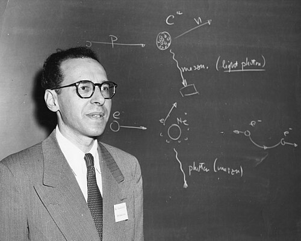

# Maurice Goldhaber

**Born:** 18 April 1911

**Died / status:** 11 May 2011

**Fields:** Nuclear physics, Neutrino physics

Sourced portrait or photograph; see the image record for provenance and reuse conditions.

## Biography

An Austrian-born American experimentalist, Goldhaber worked with Chadwick at Cambridge and later at Illinois and Brookhaven, which he directed. His nuclear experiments measured fundamental-particle properties.

## Major contributions to physics

- Investigated deuteron photodisintegration with Chadwick.
- Measured neutrino helicity with Grodzins and Sunyar.
- Investigated nuclear and particle conservation properties.

## Image source and rights

- Source: [Original image record](https://commons.wikimedia.org/wiki/File:Maurice_Goldhaber.jpg)
- Creator / attribution: AIP Emilio Segrè Visual Archives, Marshak Collection
- License or rights statement: Attribution
- Local image: [21efc344e3c1c3fab54d-34d5ac6039.jpg](../portraits/21efc344e3c1c3fab54d-34d5ac6039.jpg)
- Credit: https://repository.aip.org/goldhaber-lectures

## Sources

- [Maurice Goldhaber — reference biography (en.wikipedia.org)](https://en.wikipedia.org/wiki/Maurice_Goldhaber)
- [Brookhaven National Laboratory — In Memoriam: Maurice Goldhaber](https://www.bnl.gov/newsroom/news.php?a=22383)

Record reviewed: 2026-10-26.
