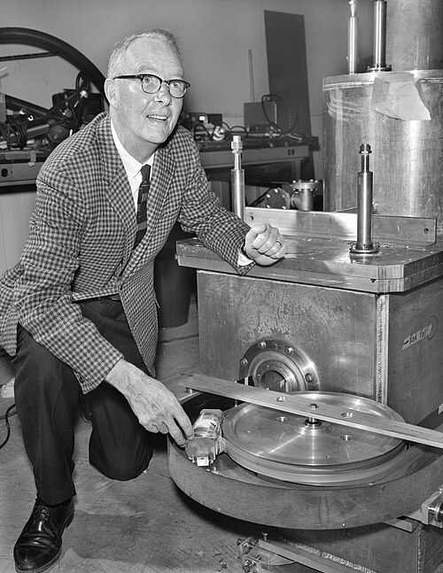

# Luis Walter Alvarez

**Born:** 13 June 1911

**Died / status:** 1 September 1988

**Fields:** Particle physics, Detection methods

For the photographer or artist, date and type of image, consult the original image record.

## Biography

Luis Walter Alvarez was born in San Francisco, CA, USA and conducted research in particle physics and detection methods. Nobel records list University of California as the affiliation at the time of the award. They developed large hydrogen bubble chambers and associated analysis methods. They were awarded the Nobel Prize in Physics in 1968.

## Major contributions to physics

- Developed large hydrogen bubble chambers and associated analysis methods
- Contributed to the discovery and investigation of hadronic resonances

**Nobel Prize in Physics:** 1968

## Image source and rights

- Source: [Original image record](https://commons.wikimedia.org/wiki/File:Luis_Alvarez_with_a_magnetic_monopole_detector_-_Restoration.jpg)
- Creator / attribution: Lawrence Berkeley National Laboratory / Department of Energy (Very minor restoration by Adam Cuerden)
- License or rights statement: Public domain
- Local image: [0b56482ae524068bc5e0.jpg](../portraits/0b56482ae524068bc5e0.jpg)
- Credit: United States National Archives and Records Administration NAID: 39146968 Local ID: 434-LB-7-XBD201111-01339

## Sources

- [Luis Alvarez - Facts](https://www.nobelprize.org/prizes/physics/1968/alvarez/facts/)
- [Nobel Prize official laureate API, id 89](https://api.nobelprize.org/2.1/laureate/89)
- [Wikipedia: Luis Walter Alvarez](https://en.wikipedia.org/wiki/Luis_Walter_Alvarez)

Record reviewed: 2026-10-26.
