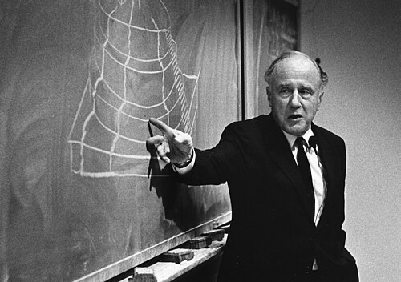

# John Archibald Wheeler

**Born:** 9 July 1911

**Died / status:** 13 April 2008

**Fields:** General relativity, Nuclear physics

Sourced photograph or portrait; the image record identifies its creator, provenance, and reuse conditions.

## Biography

An American theorist at Princeton and Texas, Wheeler moved from nuclear fission to gravitation and quantum foundations. He trained researchers including Feynman and Bekenstein and helped make black-hole physics an active research field.

## Major contributions to physics

- Developed nuclear-fission theory with Bohr.
- Formulated the Wheeler–DeWitt equation in quantum gravity with DeWitt.
- Advanced black-hole concepts, spacetime geometry, and gravitational theory.

## Image source and rights

- Source: [Original image record](https://commons.wikimedia.org/wiki/File:John_Archibald_Wheeler_lecturing.jpg)
- Creator / attribution: AIP Emilio Segrè Visual Archives, Wheeler Collection
- License or rights statement: Attribution
- Local image: [fe3c513a272b13fce91c.jpg](../portraits/fe3c513a272b13fce91c.jpg)
- Credit: https://repository.aip.org/john-archibald-wheeler-lecturing-beyond-end-time-university-missouri

## Sources

- [John Archibald Wheeler — reference biography (en.wikipedia.org)](https://en.wikipedia.org/wiki/John_Archibald_Wheeler)

Record reviewed: 2026-10-26.
