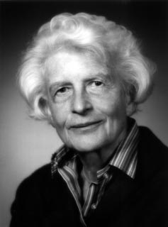

# Gertrude Scharff Goldhaber

**Born:** 14 July 1911

**Died / status:** 2 February 1998

**Fields:** Nuclear physics, Experimental physics

Sourced portrait or photograph; see the image record for provenance and reuse conditions.

## Biography

A German-born American nuclear physicist who left Nazi Germany, Scharff Goldhaber worked at Brookhaven. She investigated nuclear levels, isomers, and collective motion and advocated equal opportunities for women scientists.

## Major contributions to physics

- Investigated nuclear excited states and isomers.
- Established systematic patterns of nuclear levels with neutron number.
- Developed collective-motion models with collaborators.

## Image source and rights

- Source: [Original image record](https://en.wikipedia.org/wiki/File:Gertrude_Scharff_Goldhaber_from_Biographical_Memoirs.png)
- Creator / attribution: See the original image record
- License or rights statement: Non-free historical photograph hosted by English Wikipedia under its fair-use rationale; that rationale does not grant a reusable image licence. Permission must be confirmed before website publication.
- Local image: [484799518c284a0e5eba-52c23558c5.png](../portraits/484799518c284a0e5eba-52c23558c5.png)
- Credit: National Academy of Sciences Biographical Memoirs portrait, reproduced on English Wikipedia
- Republication: permission for use on a public website has not been verified. Confirm permission with the rightsholder or replace the image before publication.

## Sources

- [Gertrude Scharff Goldhaber — reference biography (en.wikipedia.org)](https://en.wikipedia.org/wiki/Gertrude_Scharff_Goldhaber)
- [Gertrude Scharff Goldhaber — institutional or scholarly source (cwp.library.ucla.edu)](http://cwp.library.ucla.edu/Phase2/Goldhaber,_Gertrude_Scharff@812345678.html)

Record reviewed: 2026-10-26.
