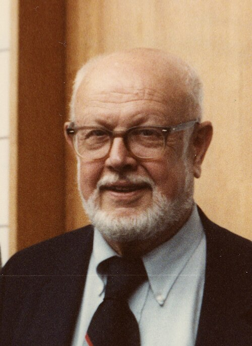

# William Alfred Fowler

**Born:** 9 August 1911

**Died / status:** 14 March 1995

**Fields:** Nuclear astrophysics, Nuclear physics

For the photographer or artist, date and type of image, consult the original image record.

## Biography

William Alfred Fowler was born in Pittsburgh, PA, USA and conducted research in nuclear astrophysics and nuclear physics. Nobel records list California Institute of Technology (Caltech) as the affiliation at the time of the award. They investigated stellar nucleosynthesis through nuclear-reaction experiments and theory. They were awarded the Nobel Prize in Physics in 1983.

## Major contributions to physics

- Investigated stellar nucleosynthesis through nuclear-reaction experiments and theory
- Explained connections between nuclear reactions and cosmic elemental abundances

**Nobel Prize in Physics:** 1983

## Image source and rights

- Source: [Original image record](https://commons.wikimedia.org/wiki/File:Fowler_1984.jpg)
- Creator / attribution: AIP Emilio Segrè Visual Archives, Clayton Collection
- License or rights statement: Attribution
- Local image: [e2d2eb7dd85112d7e15c.jpg](../portraits/e2d2eb7dd85112d7e15c.jpg)
- Credit: https://repository.aip.org/clayton-and-fowler-attend-conference

## Sources

- [William A. Fowler - Facts](https://www.nobelprize.org/prizes/physics/1983/fowler/facts/)
- [Nobel Prize official laureate API, id 123](https://api.nobelprize.org/2.1/laureate/123)
- [Wikipedia: William Alfred Fowler](https://en.wikipedia.org/wiki/William_Alfred_Fowler)

Record reviewed: 2026-10-26.
