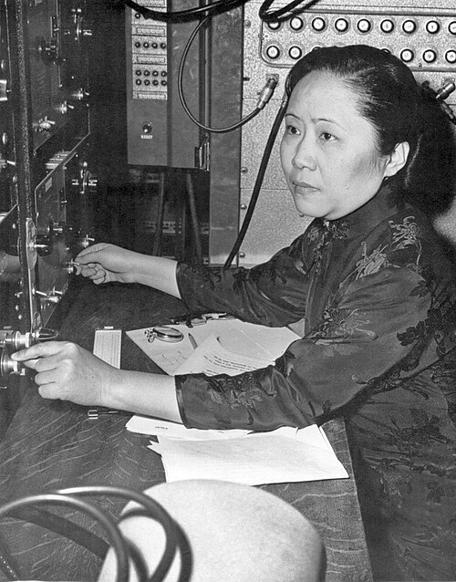

# Chien-Shiung Wu

**Born:** 31 May 1912

**Died / status:** 16 February 1997

**Fields:** Nuclear physics, Weak interactions

Sourced photograph or portrait; the image record identifies its creator, provenance, and reuse conditions.

## Biography

Born in Jiangsu, Wu earned her doctorate at Berkeley and spent much of her career at Columbia. Known for precision nuclear experiments, she later became the first woman president of the American Physical Society.

## Major contributions to physics

- Led the low-temperature cobalt-60 beta-decay experiment testing parity and establishing parity violation in the weak interaction.
- Performed precision tests of beta-decay spectra and weak-interaction theory.
- Investigated photon correlations and related quantum phenomena.

## Image source and rights

- Source: [Original image record](https://commons.wikimedia.org/wiki/File:Chien-shiung_Wu_(1912-1997)_C.jpg)
- Creator / attribution: Smithsonian Institution
- License or rights statement: [No restrictions](https://www.flickr.com/commons/usage/)
- Local image: [a021cbbb55f340c470fb.jpg](../portraits/a021cbbb55f340c470fb.jpg)
- Credit: Flickr: Chien-shiung Wu (1912-1997)

## Sources

- [Chien-Shiung Wu — biographical or institutional source (www.aip.org)](https://www.aip.org/history/teaching-guide-chien-shiung-wu-chinese-nuclear-physicist)
- [Chien-Shiung Wu — reference biography (en.wikipedia.org)](https://en.wikipedia.org/wiki/Chien-Shiung_Wu)

Record reviewed: 2026-10-26.
