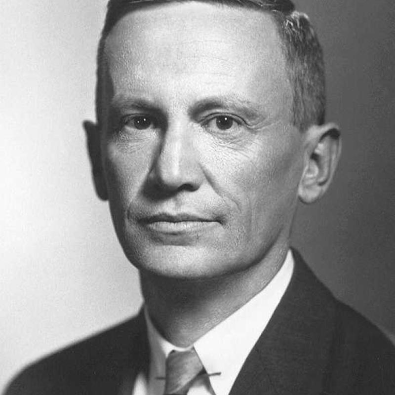

# Martin Schwarzschild

**Born:** 31 May 1912

**Died / status:** 10 April 1997

**Fields:** Stellar physics, Computational physics

Sourced portrait or photograph; see the image record for provenance and reuse conditions.

## Biography

A German-born American astrophysicist at Princeton, Schwarzschild used early computers to investigate stellar interiors and evolution. He also developed high-altitude astronomical observations.

## Major contributions to physics

- Advanced numerical stellar-structure and evolution calculations.
- Investigated convection and post-main-sequence evolution.
- Developed Stratoscope balloon-telescope observations.

## Image source and rights

- Source: [Original image record](https://phys-astro.sonoma.edu/brucemedalists/martin-schwarzschild)
- Creator / attribution: See the original image record
- License or rights statement: Copyrighted image; no transferable open licence verified. Permission must be confirmed before website publication.
- Local image: [b12b223654f8880a105c-ffafa82397.jpg](../portraits/b12b223654f8880a105c-ffafa82397.jpg)
- Credit: Princeton University, 1965, courtesy Prof. Schwarzschild; Sonoma State University Bruce Medal archive
- Republication: permission for use on a public website has not been verified. Confirm permission with the rightsholder or replace the image before publication.

## Sources

- [Martin Schwarzschild — reference biography (en.wikipedia.org)](https://en.wikipedia.org/wiki/Martin_Schwarzschild)

Record reviewed: 2026-10-26.
