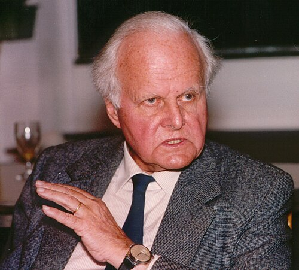

# Carl Friedrich von Weizsäcker

**Born:** 28 June 1912

**Died / status:** 28 April 2007

**Fields:** Nuclear physics, Nuclear astrophysics, Theoretical physics

Consult the original image record for the creator, date and form of the image.

## Biography

Weizsäcker was a German physicist and philosopher influenced by Heisenberg. His research addressed atomic nuclei, stellar energy and planetary formation. He later worked in Hamburg and within the Max Planck Society and pursued questions of scientific responsibility and peace, while his physical work influenced nuclear structure and astrophysics.

## Major contributions to physics

- Developed a semi-empirical mass formula describing nuclear binding energies
- Investigated stellar nuclear reactions and independently contributed to the theory of the carbon–nitrogen–oxygen cycle
- Studied planetary-system formation and foundational questions in theoretical physics

## Image source and rights

- Source: [Original image record](https://commons.wikimedia.org/wiki/File:Carl_Friedrich_von_Weizsaecker.jpg)
- Creator / attribution: Ian Howard (of the original picture)
- License or rights statement: [CC BY-SA 3.0](http://creativecommons.org/licenses/by-sa/3.0/)
- Local image: [d221685fdf664bade538-e776fc6496.jpg](../portraits/d221685fdf664bade538-e776fc6496.jpg)
- Credit: Modified version of Image:Friedric Hund1.jpg, showing only the person on the left.

## Sources

- [German Research Foundation: Carl Friedrich von Weizsäcker](https://gepris-historisch.dfg.de/person/5113433)
- [University of Leipzig: Carl Friedrich von Weizsäcker](https://research.uni-leipzig.de/agintern/UNIGESCH/ug213.htm)
- [University of Hamburg: biography and publications](https://www.chemie.uni-hamburg.de/forschung/publikationen/erweiterung/dozenten-uhh/weizsaecker.html)
- [Wikipedia: Carl Friedrich von Weizsäcker](https://en.wikipedia.org/wiki/Carl_Friedrich_von_Weizs%C3%A4cker)

Record reviewed: 2026-10-26.
