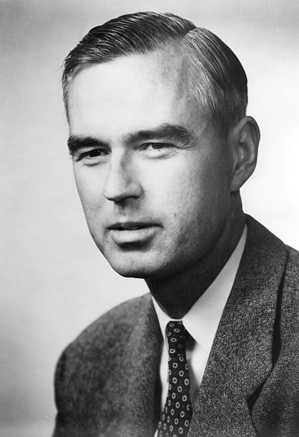

# Willis Eugene Lamb

**Born:** 12 July 1913

**Died / status:** 15 May 2008

**Fields:** Atomic physics, Quantum electrodynamics

For the photographer or artist, date and type of image, consult the original image record.

## Biography

Willis Eugene Lamb was born in Los Angeles, CA, USA and conducted research in atomic physics and quantum electrodynamics. Nobel records list Stanford University as the affiliation at the time of the award. They discovered the Lamb shift in the fine structure of hydrogen energy levels. They were awarded the Nobel Prize in Physics in 1955.

## Major contributions to physics

- Discovered the Lamb shift in the fine structure of hydrogen energy levels
- Provided a precise experimental test of radiative corrections in quantum electrodynamics

**Nobel Prize in Physics:** 1955

## Image source and rights

- Source: [Original image record](https://commons.wikimedia.org/wiki/File:Willis_E._Lamb.jpg)
- Creator / attribution: Credit Line: AIP Emilio Segrè Visual Archives, W. F. Meggers Gallery of Nobel Laureates Collection
- License or rights statement: Copyrighted free use
- Local image: [9458904b76101e70d676.jpg](../portraits/9458904b76101e70d676.jpg)
- Credit: https://repository.aip.org/islandora/object/nbla%3A308422

## Sources

- [Willis E. Lamb - Facts](https://www.nobelprize.org/prizes/physics/1955/lamb/facts/)
- [Nobel Prize official laureate API, id 63](https://api.nobelprize.org/2.1/laureate/63)
- [Wikipedia: Willis Lamb](https://en.wikipedia.org/wiki/Willis_Lamb)

Record reviewed: 2026-10-26.
