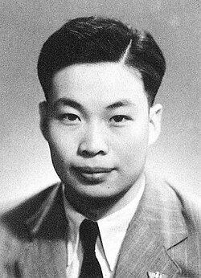

# Qian Sanqiang

**Born:** 16 October 1913

**Died / status:** 28 June 1992

**Fields:** Nuclear physics

Sourced photograph or portrait; the image record identifies its creator, provenance, and reuse conditions.

## Biography

A Chinese nuclear physicist educated at Tsinghua, Qian investigated fission with He Zehui and colleagues at the Curie laboratory in Paris. Returning to China in 1948, he helped establish the Institute of Modern Physics and organize early nuclear research.

## Major contributions to physics

- Investigated and helped establish ternary and quaternary uranium-fission processes with He Zehui and colleagues.
- Built Chinese nuclear-physics teams and experimental facilities.
- Advanced atomic-energy research and scientific training.

## Image source and rights

- Source: [Original image record](https://commons.wikimedia.org/wiki/File:%E5%B9%B4%E8%BD%BB%E7%9A%84%E9%92%B1%E4%B8%89%E5%BC%BA.jpg)
- Creator / attribution: Unknown
- License or rights statement: [Public domain — Commons source tag (PD-China or PD-scan)](https://commons.wikimedia.org/wiki/File:%E5%B9%B4%E8%BD%BB%E7%9A%84%E9%92%B1%E4%B8%89%E5%BC%BA.jpg)
- Local image: [1a044ca9b3ce673cc58c-484900b62a.jpg](../portraits/1a044ca9b3ce673cc58c-484900b62a.jpg)
- Credit: Original credit is retained in the source record.

## Sources

- [Qian Sanqiang — biographical or institutional source (www.cas.cn)](https://www.cas.cn/xzfc/202206/t20220630_4840013.shtml)
- [Qian Sanqiang — reference biography (en.wikipedia.org)](https://en.wikipedia.org/wiki/Qian_Sanqiang)

Record reviewed: 2026-10-26.
