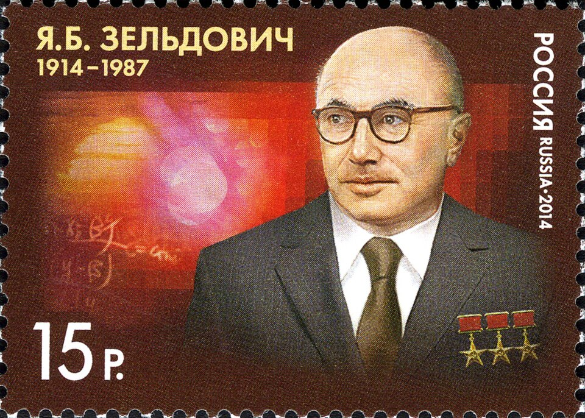

# Yakov Zeldovich

**Born:** 8 March 1914

**Died / status:** 2 December 1987

**Fields:** Cosmology, Theoretical physics

Sourced photograph or portrait; the image record identifies its creator, provenance, and reuse conditions.

## Biography

Born in Minsk, the Soviet theoretical physicist Zeldovich worked on combustion, detonation, and nuclear reactions before turning to cosmology. He applied fluid dynamics, statistical theory, and particle processes to cosmic structure and helped train a major school of cosmologists.

## Major contributions to physics

- Predicted distortions of the cosmic microwave background caused by scattering of its photons by hot electrons, with Sunyaev.
- Developed the Zeldovich approximation for structure formation.
- Investigated early-universe particle processes and combustion and detonation.

## Historical and source notes

- The birth date uses the Gregorian calendar; some Russian historical sources also give the Julian date.

## Image source and rights

- Source: [Original image record](https://commons.wikimedia.org/wiki/File:Stamp_of_Russia_2014_YaB_Zel%27dovich.jpg)
- Creator / attribution: Stamp issuing authority - MARKA Publishing & Trading Centre. Printer - Association GOZNAK of the Ministry of Finance of the Russian Federation
- License or rights statement: Public domain
- Local image: [4cba61cc6d5d51299c32.jpg](../portraits/4cba61cc6d5d51299c32.jpg)
- Credit: http://www.wnsstamps.post/en/stamps/RU055.14

## Sources

- [Yakov Zeldovich — reference biography (en.wikipedia.org)](https://en.wikipedia.org/wiki/Yakov_Zeldovich)

Record reviewed: 2026-10-26.
