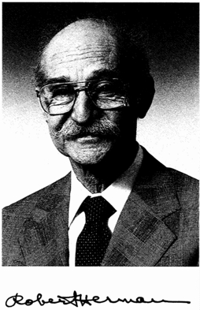

# Robert Herman

**Born:** 29 August 1914

**Died / status:** 13 February 1997

**Fields:** Cosmology, Statistical physics

Portrait extracted unchanged from p. 108 of the National Academy of Engineering’s Memorial Tributes, Volume 9, including the original signature.

## Biography

An American physicist, Herman worked on spectroscopy and wartime technology before studying cosmology, industrial problems, and traffic flow. His collaboration with Alpher connected early-universe nuclear physics with relic thermal radiation.

## Major contributions to physics

- Estimated the temperature of relic cosmic radiation with Alpher.
- Investigated primordial nucleosynthesis and cosmic thermal evolution.
- Applied statistical-physics methods to traffic and complex systems.

## Image source and rights

- Source: [Original image record](https://www.nae.edu/File.aspx?id=188206)
- Creator / attribution: See the original image record
- License or rights statement: Copyrighted image; no transferable open licence verified. Permission must be confirmed before website publication.
- Local image: [5c0c6645142798d713c2-265e9ee7d7.jpg](../portraits/5c0c6645142798d713c2-265e9ee7d7.jpg)
- Credit: National Academy of Engineering, Memorial Tributes, Volume 9, p. 108; copyright National Academy of Sciences
- Republication: permission for use on a public website has not been verified. Confirm permission with the rightsholder or replace the image before publication.

## Sources

- [Robert Herman — reference biography (en.wikipedia.org)](https://en.wikipedia.org/wiki/Robert_Herman)

Record reviewed: 2026-10-26.
