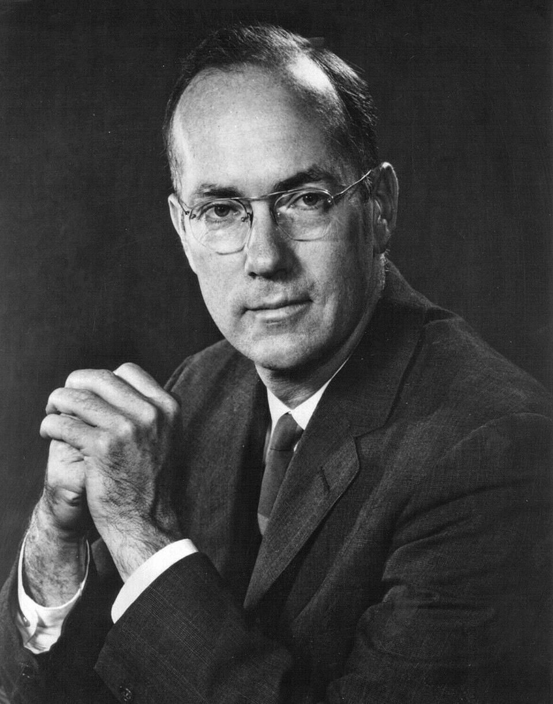

# Charles Hard Townes

**Born:** 28 July 1915

**Died / status:** 27 January 2015

**Fields:** Quantum electronics, Lasers

For the photographer or artist, date and type of image, consult the original image record.

## Biography

Charles Hard Townes was born in Greenville, SC, USA and conducted research in quantum electronics and lasers. Nobel records list Massachusetts Institute of Technology (MIT) as the affiliation at the time of the award. They developed microwave amplification and oscillation based on stimulated emission. They were awarded the Nobel Prize in Physics in 1964.

## Major contributions to physics

- Developed microwave amplification and oscillation based on stimulated emission
- Established important theoretical and experimental foundations for masers and lasers

**Nobel Prize in Physics:** 1964

## Image source and rights

- Source: [Original image record](https://commons.wikimedia.org/wiki/File:Charles_Townes.jpg)
- Creator / attribution: Unknown author
- License or rights statement: Public domain
- Local image: [bb8455d3d4d6c5f65600.jpg](../portraits/bb8455d3d4d6c5f65600.jpg)
- Credit: [1]

## Sources

- [Charles H. Townes - Facts](https://www.nobelprize.org/prizes/physics/1964/townes/facts/)
- [Nobel Prize official laureate API, id 81](https://api.nobelprize.org/2.1/laureate/81)
- [Wikipedia: Charles Hard Townes](https://en.wikipedia.org/wiki/Charles_Hard_Townes)

Record reviewed: 2026-10-26.
