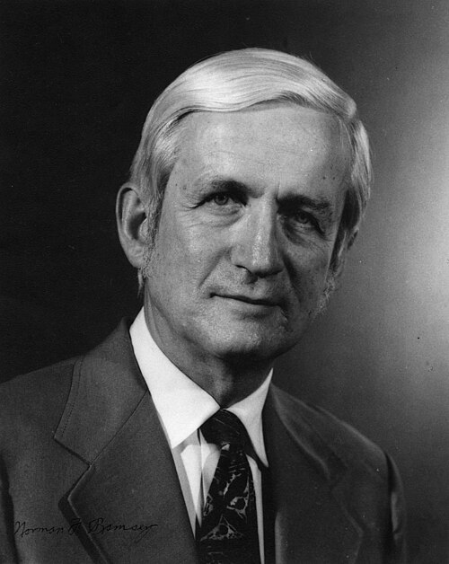

# Norman F. Ramsey

**Born:** 27 August 1915

**Died / status:** 4 November 2011

**Fields:** Atomic physics, Precision measurement

For the photographer or artist, date and type of image, consult the original image record.

## Biography

Norman F. Ramsey was born in Washington, D.C., USA and conducted research in atomic physics and precision measurement. Nobel records list Harvard University as the affiliation at the time of the award. They invented the separated-oscillatory-fields method. They were awarded the Nobel Prize in Physics in 1989.

## Major contributions to physics

- Invented the separated-oscillatory-fields method
- Established foundations for atomic clocks and precise frequency standards

**Nobel Prize in Physics:** 1989

## Image source and rights

- Source: [Original image record](https://commons.wikimedia.org/wiki/File:Ramsey_Norman_A3.jpg)
- Creator / attribution: Credit Line: AIP Emilio Segrè Visual Archives, W. F. Meggers Gallery of Nobel Laureates Collection
- License or rights statement: Copyrighted free use
- Local image: [0986c4a67d72068135a8.jpg](../portraits/0986c4a67d72068135a8.jpg)
- Credit: https://repository.aip.org/islandora/object/nbla%3A303931

## Sources

- [Norman F. Ramsey - Facts](https://www.nobelprize.org/prizes/physics/1989/ramsey/facts/)
- [Nobel Prize official laureate API, id 135](https://api.nobelprize.org/2.1/laureate/135)
- [Wikipedia: Norman Foster Ramsey, Jr.](https://en.wikipedia.org/wiki/Norman_Foster_Ramsey%2C_Jr.)

Record reviewed: 2026-10-26.
