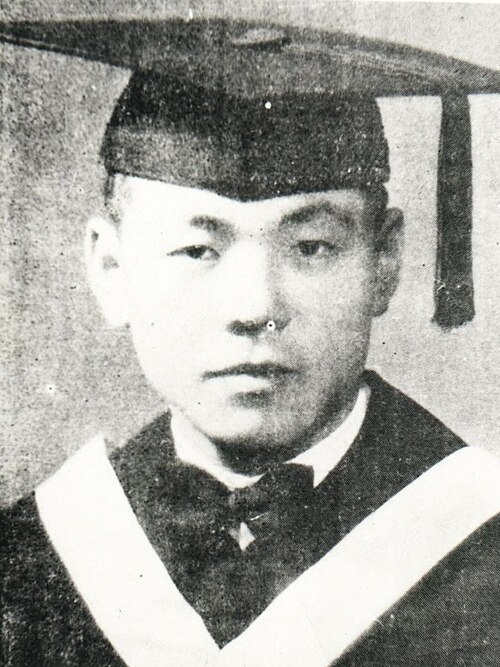

# Peng Huanwu

**Born:** 6 October 1915

**Died / status:** 28 February 2007

**Fields:** Theoretical physics, Nuclear physics

Sourced photograph or portrait; the image record identifies its creator, provenance, and reuse conditions.

## Biography

Born in Changchun, Peng graduated from Tsinghua, studied with Born in Edinburgh, and worked in Dublin. Returning to China in 1947, he helped develop theoretical physics and nuclear-weapons research while supporting scientific institutions and training.

## Major contributions to physics

- Investigated solids and quantum field theory.
- Organized and contributed to Chinese atomic- and hydrogen-bomb theoretical design.
- Helped establish the Institute of Theoretical Physics and train researchers.

## Image source and rights

- Source: [Original image record](https://commons.wikimedia.org/wiki/File:%E5%BD%AD%E6%A1%93%E6%AD%A6%E5%AD%A6%E5%A3%AB.jpg)
- Creator / attribution: Unknown
- License or rights statement: [Public domain — Commons source tag (PD-China or PD-scan)](https://commons.wikimedia.org/wiki/File:%E5%BD%AD%E6%A1%93%E6%AD%A6%E5%AD%A6%E5%A3%AB.jpg)
- Local image: [7a03620c9c5987fabeac-b0b5984205.jpg](../portraits/7a03620c9c5987fabeac-b0b5984205.jpg)
- Credit: Original credit is retained in the source record.

## Sources

- [Peng Huanwu — reference biography (en.wikipedia.org)](https://en.wikipedia.org/wiki/Peng_Huanwu)

Record reviewed: 2026-10-26.
