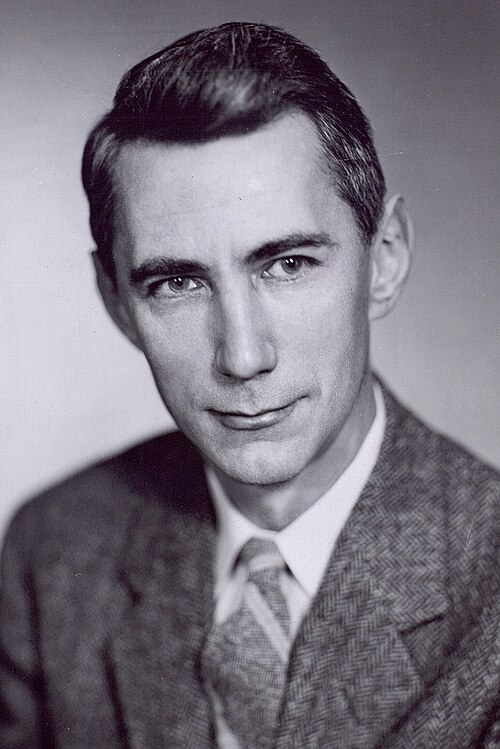

# Claude Shannon

**Born:** 30 April 1916

**Died / status:** 24 February 2001

**Fields:** Information theory, Statistical physics

Sourced portrait or photograph; see the image record for provenance and reuse conditions.

## Biography

An American mathematician and electrical engineer at Bell Laboratories and MIT, Shannon established a probabilistic theory of communication and applied Boolean algebra to switching circuits. He is included for foundational contributions relevant to the physics of information.

## Major contributions to physics

- Established information theory through entropy and channel capacity.
- Applied Boolean algebra to switching-circuit analysis.
- Investigated coding limits and cryptographic systems.

## Image source and rights

- Source: [Original image record](https://commons.wikimedia.org/wiki/File:C.E._Shannon._Tekniska_museet_43069_(2x3_crop).jpg)
- Creator / attribution: Unknown author
- License or rights statement: [CC BY 2.0](https://creativecommons.org/licenses/by/2.0)
- Local image: [23d8ba88a4c0c5f28008-0403bd1e98.jpg](../portraits/23d8ba88a4c0c5f28008-0403bd1e98.jpg)
- Credit: Tekniska Museet of Sweden, Item 43069 via Flickr

## Sources

- [Claude Shannon — institutional or reference biography (maglabweb.magnet.fsu.edu)](https://maglabweb.magnet.fsu.edu/magnet-academy/history-of-electricity-magnetism/pioneers/claude-shannon/)
- [Claude Shannon — institutional or reference biography (en.wikipedia.org)](https://en.wikipedia.org/wiki/Claude_Shannon)

Record reviewed: 2026-10-26.
