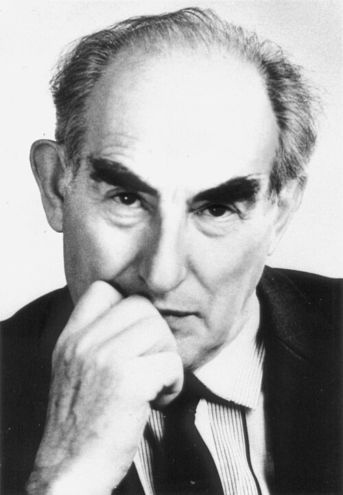

# Vitaly Lazarevich Ginzburg

**Born:** 4 October 1916

**Died / status:** 8 November 2009

**Fields:** Condensed-matter physics, Superconductivity

For the photographer or artist, date and type of image, consult the original image record.

## Biography

Vitaly Lazarevich Ginzburg was born in Moscow, Russia and conducted research in condensed-matter physics and superconductivity. Nobel records list P.N. Lebedev Physical Institute as the affiliation at the time of the award. They developed the Ginzburg-Landau phenomenological theory of superconductivity with Lev Landau. They were awarded the Nobel Prize in Physics in 2003.

## Major contributions to physics

- Developed the Ginzburg-Landau phenomenological theory of superconductivity with Lev Landau
- Described superconducting transitions and spatial variation through an order parameter and free energy

**Nobel Prize in Physics:** 2003

## Image source and rights

- Source: [Original image record](https://commons.wikimedia.org/wiki/File:%D0%92%D0%B8%D1%82%D0%B0%D0%BB%D0%B8%D0%B9_%D0%9B%D0%B0%D0%B7%D0%B0%D1%80%D0%B5%D0%B2%D0%B8%D1%87_%D0%93%D0%B8%D0%BD%D0%B7%D0%B1%D1%83%D1%80%D0%B3.jpg)
- Creator / attribution: Vitaly Ginzburg
- License or rights statement: [CC SA 1.0](http://creativecommons.org/licenses/sa/1.0/)
- Local image: [b41c496967d7ae8d326f.jpg](../portraits/b41c496967d7ae8d326f.jpg)
- Credit: http://ufn.ru/ru/events/history.html#ginzburg85

## Sources

- [Vitaly L. Ginzburg - Facts](https://www.nobelprize.org/prizes/physics/2003/ginzburg/facts/)
- [Nobel Prize official laureate API, id 767](https://api.nobelprize.org/2.1/laureate/767)
- [Wikipedia: Vitaly Ginzburg](https://en.wikipedia.org/wiki/Vitaly_Ginzburg)

Record reviewed: 2026-10-26.
