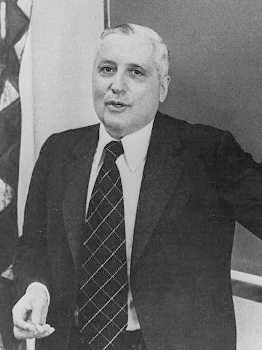

# Ilya Prigogine

**Born:** 25 January 1917

**Died / status:** 28 May 2003

**Fields:** Nonequilibrium thermodynamics, Complex systems

Sourced photograph or portrait; the image record identifies its creator, provenance, and reuse conditions.

## Biography

A Russian-born Belgian physical chemist at Brussels and Texas, Prigogine investigated how open systems far from equilibrium form ordered structures. His work on nonequilibrium thermodynamics earned the 1977 Nobel Prize in Chemistry.

## Major contributions to physics

- Developed irreversible and nonequilibrium thermodynamics.
- Introduced dissipative structures to describe ordered patterns maintained by flows through open systems.
- Investigated time irreversibility and complex dynamics.

## Image source and rights

- Source: [Original image record](https://commons.wikimedia.org/wiki/File:Ilya_Prigogine_1977c.jpg)
- Creator / attribution: Unknown (Keystone - US)
- License or rights statement: Public domain
- Local image: [48816e559e8a81e5891d.jpg](../portraits/48816e559e8a81e5891d.jpg)
- Credit: File:Ilya Prigogine 1977.jpg

## Sources

- [Ilya Prigogine — reference biography (en.wikipedia.org)](https://en.wikipedia.org/wiki/Ilya_Prigogine)

Record reviewed: 2026-10-26.
