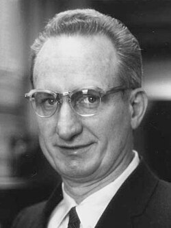

# Leo James Rainwater

**Born:** 9 December 1917

**Died / status:** 31 May 1986

**Fields:** Nuclear physics, Nuclear structure

For the photographer or artist, date and type of image, consult the original image record.

## Biography

Leo James Rainwater was born in Council, ID, USA and conducted research in nuclear physics and nuclear structure. Nobel records list Columbia University as the affiliation at the time of the award. They connected collective nuclear motion with individual-particle motion. They were awarded the Nobel Prize in Physics in 1975.

## Major contributions to physics

- Connected collective nuclear motion with individual-particle motion
- Developed a theory of the structure of deformed nuclei

**Nobel Prize in Physics:** 1975

## Image source and rights

- Source: [Original image record](https://commons.wikimedia.org/wiki/File:James_Rainwater_2.jpg)
- Creator / attribution: Keystone
- License or rights statement: Public domain
- Local image: [0569433ccf832a536aa1.jpg](../portraits/0569433ccf832a536aa1.jpg)
- Credit: File:James Rainwater.jpg

## Sources

- [James Rainwater - Facts](https://www.nobelprize.org/prizes/physics/1975/rainwater/facts/)
- [Nobel Prize official laureate API, id 104](https://api.nobelprize.org/2.1/laureate/104)
- [Wikipedia: James Rainwater](https://en.wikipedia.org/wiki/James_Rainwater)

Record reviewed: 2026-10-26.
