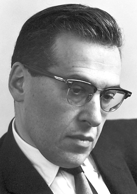

# Julian Schwinger

**Born:** 12 February 1918

**Died / status:** 16 July 1994

**Fields:** Quantum electrodynamics, Particle physics

For the photographer or artist, date and type of image, consult the original image record.

## Biography

Julian Schwinger was born in New York, NY, USA and conducted research in quantum electrodynamics and particle physics. Nobel records list Harvard University as the affiliation at the time of the award. They developed renormalized quantum electrodynamics. They were awarded the Nobel Prize in Physics in 1965.

## Major contributions to physics

- Developed renormalized quantum electrodynamics
- Enabled highly precise calculations of interactions between electrons and electromagnetic fields

**Nobel Prize in Physics:** 1965

## Image source and rights

- Source: [Original image record](https://commons.wikimedia.org/wiki/File:Schwinger.jpg)
- Creator / attribution: Nobel foundation
- License or rights statement: Public domain
- Local image: [d332287ab1a594e2b5ac.jpg](../portraits/d332287ab1a594e2b5ac.jpg)
- Credit: http://nobelprize.org/nobel_prizes/physics/laureates/1965/schwinger-bio.html

## Sources

- [Julian Schwinger - Facts](https://www.nobelprize.org/prizes/physics/1965/schwinger/facts/)
- [Nobel Prize official laureate API, id 85](https://api.nobelprize.org/2.1/laureate/85)
- [Wikipedia: Julian Schwinger](https://en.wikipedia.org/wiki/Julian_Schwinger)

Record reviewed: 2026-10-26.
