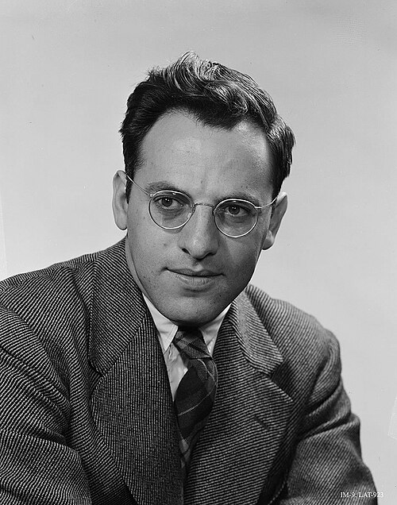

# Frederick Reines

**Born:** 16 March 1918

**Died / status:** 26 August 1998

**Fields:** Particle physics, Neutrinos

For the photographer or artist, date and type of image, consult the original image record.

## Biography

Frederick Reines was born in Paterson, NJ, USA and conducted research in particle physics and neutrinos. Nobel records list University of California as the affiliation at the time of the award. They first directly detected electron antineutrinos with Clyde Cowan in reactor experiments. They were awarded the Nobel Prize in Physics in 1995.

## Major contributions to physics

- First directly detected electron antineutrinos with Clyde Cowan in reactor experiments
- Provided experimental confirmation of the neutrino's existence

**Nobel Prize in Physics:** 1995

## Image source and rights

- Source: [Original image record](https://commons.wikimedia.org/wiki/File:Frederick_Reines,_early_1950s.jpg)
- Creator / attribution: Los Alamos National Laboratory
- License or rights statement: Attribution
- Local image: [6031b220ab98e69dd804.jpg](../portraits/6031b220ab98e69dd804.jpg)
- Credit: https://discover.lanl.gov/news/1029-ghost-particles/, https://www.lindahall.org/about/news/scientist-of-the-day/frederick-reines

## Sources

- [Frederick Reines - Facts](https://www.nobelprize.org/prizes/physics/1995/reines/facts/)
- [Nobel Prize official laureate API, id 148](https://api.nobelprize.org/2.1/laureate/148)
- [Wikipedia: Frederick Reines](https://en.wikipedia.org/wiki/Frederick_Reines)

Record reviewed: 2026-10-26.
