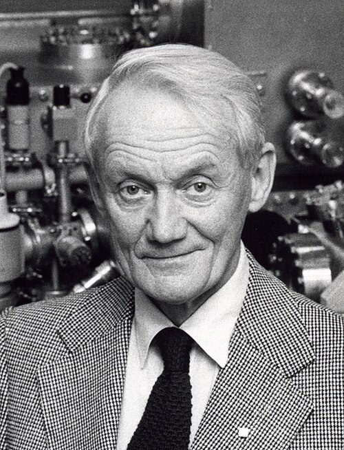

# Kai M. Siegbahn

**Born:** 20 April 1918

**Died / status:** 20 July 2007

**Fields:** Electron spectroscopy, Atomic physics

For the photographer or artist, date and type of image, consult the original image record.

## Biography

Kai M. Siegbahn was born in Lund, Sweden and conducted research in electron spectroscopy and atomic physics. Nobel records list Uppsala University as the affiliation at the time of the award. They developed high-resolution electron-spectroscopy methods. They were awarded the Nobel Prize in Physics in 1981.

## Major contributions to physics

- Developed high-resolution electron-spectroscopy methods
- Used photoelectron energies to investigate chemical environments and electronic structure

**Nobel Prize in Physics:** 1981

## Image source and rights

- Source: [Original image record](https://commons.wikimedia.org/wiki/File:Kai_Manne_B%C3%B6rje_Siegbahn_2.jpg)
- Creator / attribution: Kai_Manne_Börje_Siegbahn.jpg: Jan Collsiöö derivative work: Materialscientist
- License or rights statement: [CC BY-SA 3.0 nl](https://commons.wikimedia.org/wiki/File:Kai_Manne_B%C3%B6rje_Siegbahn_2.jpg)
- Local image: [bb93d565e80c23674ba6.jpg](../portraits/bb93d565e80c23674ba6.jpg)
- Credit: This file was derived from: Kai Manne Börje Siegbahn.jpg:

## Sources

- [Kai M. Siegbahn - Facts](https://www.nobelprize.org/prizes/physics/1981/siegbahn/facts/)
- [Nobel Prize official laureate API, id 120](https://api.nobelprize.org/2.1/laureate/120)
- [Wikipedia: Kai Siegbahn](https://en.wikipedia.org/wiki/Kai_Siegbahn)

Record reviewed: 2026-10-26.
