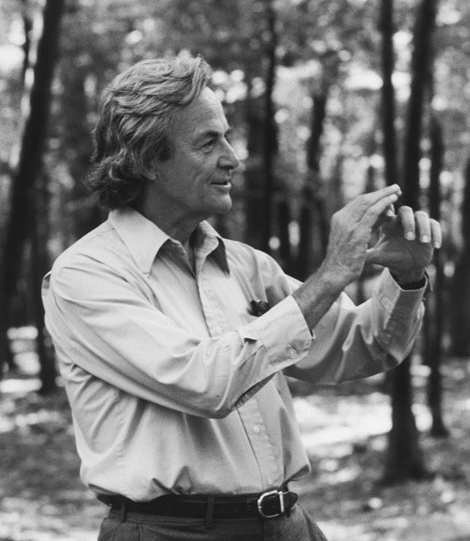

# Richard P. Feynman

**Born:** 11 May 1918

**Died / status:** 15 February 1988

**Fields:** Quantum electrodynamics, Quantum theory

For the photographer or artist, date and type of image, consult the original image record.

## Biography

Richard P. Feynman was born in New York, NY, USA and conducted research in quantum electrodynamics and quantum theory. Nobel records list California Institute of Technology (Caltech) as the affiliation at the time of the award. They developed computational methods and Feynman diagrams for quantum electrodynamics. They were awarded the Nobel Prize in Physics in 1965.

## Major contributions to physics

- Developed computational methods and Feynman diagrams for quantum electrodynamics
- Formulated the path-integral approach and investigated quantum many-body phenomena including superfluidity

**Nobel Prize in Physics:** 1965

## Image source and rights

- Source: [Original image record](https://commons.wikimedia.org/wiki/File:RichardFeynman-PaineMansionWoods1984_copyrightTamikoThiel_bw.jpg)
- Creator / attribution: Tamiko Thiel
- License or rights statement: [CC BY-SA 3.0](https://creativecommons.org/licenses/by-sa/3.0)
- Local image: [8859a9751fad4895e26e-0ab8c9840c.jpg](../portraits/8859a9751fad4895e26e-0ab8c9840c.jpg)
- Credit: communication from photographer

## Sources

- [Richard P. Feynman - Facts](https://www.nobelprize.org/prizes/physics/1965/feynman/facts/)
- [Nobel Prize official laureate API, id 86](https://api.nobelprize.org/2.1/laureate/86)
- [Wikipedia: Richard Feynman](https://en.wikipedia.org/wiki/Richard_Feynman)

Record reviewed: 2026-10-26.
