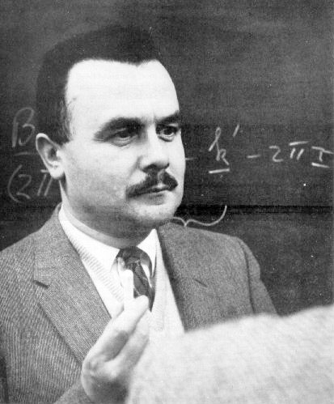

# Bertram N. Brockhouse

**Born:** 15 July 1918

**Died / status:** 13 October 2003

**Fields:** Neutron scattering, Condensed-matter physics

For the photographer or artist, date and type of image, consult the original image record.

## Biography

Bertram N. Brockhouse was born in Lethbridge, Alberta, Canada and conducted research in neutron scattering and condensed-matter physics. Nobel records list McMaster University as the affiliation at the time of the award. They developed neutron spectroscopy and the triple-axis spectrometer. They were awarded the Nobel Prize in Physics in 1994.

## Major contributions to physics

- Developed neutron spectroscopy and the triple-axis spectrometer
- Used inelastic neutron scattering to investigate lattice vibrations and microscopic dynamics

**Nobel Prize in Physics:** 1994

## Image source and rights

- Source: [Original image record](https://commons.wikimedia.org/wiki/File:Bertram_Brockhouse.jpg)
- Creator / attribution: See the original image record
- License or rights statement: Public domain
- Local image: [a90f50be0a8c3092fe46.jpg](../portraits/a90f50be0a8c3092fe46.jpg)

## Sources

- [Bertram N. Brockhouse - Facts](https://www.nobelprize.org/prizes/physics/1994/brockhouse/facts/)
- [Nobel Prize official laureate API, id 145](https://api.nobelprize.org/2.1/laureate/145)
- [Wikipedia: Bertram Brockhouse](https://en.wikipedia.org/wiki/Bertram_Brockhouse)

Record reviewed: 2026-10-26.
