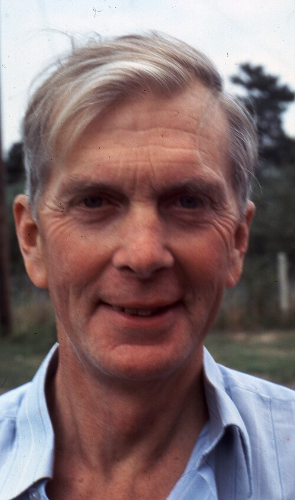

# Sir Martin Ryle

**Born:** 27 September 1918

**Died / status:** 14 October 1984

**Fields:** Radio astronomy, Interferometry

For the photographer or artist, date and type of image, consult the original image record.

## Biography

Sir Martin Ryle was born in Brighton, United Kingdom and conducted research in radio astronomy and interferometry. Nobel records list University of Cambridge as the affiliation at the time of the award. They developed radio interferometry and aperture synthesis. They were awarded the Nobel Prize in Physics in 1974.

## Major contributions to physics

- Developed radio interferometry and aperture synthesis
- Improved angular resolution and enabled systematic investigation of radio sources

**Nobel Prize in Physics:** 1974

## Image source and rights

- Source: [Original image record](https://commons.wikimedia.org/wiki/File:Martin_Ryle_1976.jpg)
- Creator / attribution: AIP Emilio Segrè Visual Archives, John Irwin Slide Collection
- License or rights statement: Attribution
- Local image: [99b1fda8215b0de861ba.jpg](../portraits/99b1fda8215b0de861ba.jpg)
- Credit: https://repository.aip.org/martin-ryle-international-astronomical-union-iau-conference

## Sources

- [Martin Ryle - Facts](https://www.nobelprize.org/prizes/physics/1974/ryle/facts/)
- [Nobel Prize official laureate API, id 100](https://api.nobelprize.org/2.1/laureate/100)
- [Wikipedia: Martin Ryle](https://en.wikipedia.org/wiki/Martin_Ryle)

Record reviewed: 2026-10-26.
