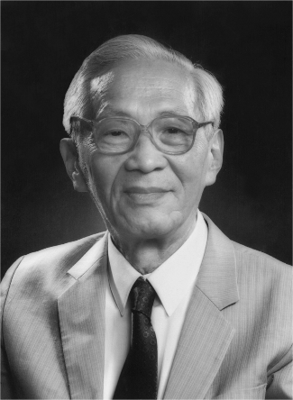

# Wang Shouwu

**Born:** 15 March 1919

**Died / status:** 30 July 2014

**Fields:** Semiconductor physics, Semiconductor devices

Sourced photograph or portrait; the image record identifies its creator, provenance, and reuse conditions.

## Biography

Born in Suzhou, Jiangsu, Wang received his doctorate at Purdue and returned to China in 1950. He helped establish the Institute of Semiconductors, combining fundamental semiconductor research with devices, fabrication, and scientific training.

## Major contributions to physics

- Investigated semiconductor transistors, integrated circuits, and device physics.
- Advanced semiconductor-device development and fabrication in China.
- Built semiconductor research institutions and trained technical specialists.

## Image source and rights

- Source: [Original image record](https://ime.cas.cn/skjs/yszj/201809/t20180915_5078653.html)
- Creator / attribution: Photographer not identified
- License or rights statement: Copyrighted or republication permission unverified; consult the original record
- Local image: [14dbc76afb67464803f8-948a9f2ebe.png](../portraits/14dbc76afb67464803f8-948a9f2ebe.png)
- Credit: Original credit is retained in the source record.
- Republication: permission for use on a public website has not been verified. Confirm permission with the rightsholder or replace the image before publication.

## Sources

- [Wang Shouwu — biographical or institutional source (english.ime.cas.cn)](https://english.ime.cas.cn/pe/cm/200909/t20090904_35631.html)
- [Wang Shouwu — biographical or institutional source (www.cas.cn)](https://www.cas.cn/xzfc/202311/t20231116_4985900.shtml)

Record reviewed: 2026-10-26.
