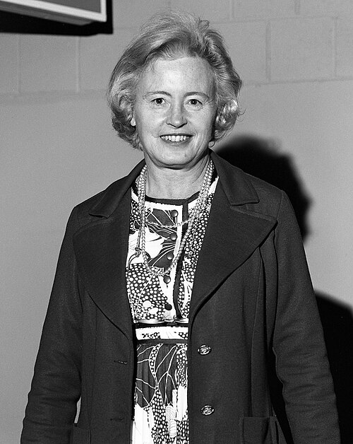

# Margaret Burbidge

**Born:** 12 August 1919

**Died / status:** 5 April 2020

**Fields:** Astronomical spectroscopy, Nuclear astrophysics

Sourced portrait or photograph; see the image record for provenance and reuse conditions.

## Biography

A British-born American astrophysicist at UC San Diego and former director of the Royal Greenwich Observatory, Burbidge used stellar and galactic spectra to investigate elemental origins and advocated equality for women in astronomy.

## Major contributions to physics

- Coauthored the B²FH synthesis of stellar nucleosynthesis.
- Investigated elemental abundances through stellar spectra.
- Studied galaxies and quasars and helped develop Hubble's spectrograph.

## Image source and rights

- Source: [Original image record](https://commons.wikimedia.org/wiki/File:Margaret_Burbidge_1974.jpg)
- Creator / attribution: AIP Emilio Segrè Visual Archives, Blustine Collection, Gift of Martin Blustine
- License or rights statement: Attribution
- Local image: [e7bc789f1f19460d3775-cb2e159032.jpg](../portraits/e7bc789f1f19460d3775-cb2e159032.jpg)
- Credit: https://repository.aip.org/margaret-burbidge-mount-holyoke-college-0

## Sources

- [Margaret Burbidge — institutional or reference biography (today.ucsd.edu)](https://today.ucsd.edu/story/physics-pioneer-margaret-burbidge-dies-at-100)
- [Margaret Burbidge — institutional or reference biography (en.wikipedia.org)](https://en.wikipedia.org/wiki/Margaret_Burbidge)

Record reviewed: 2026-10-26.
