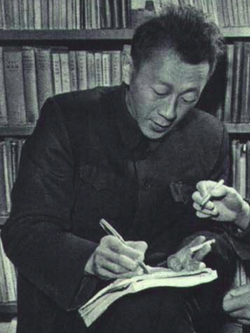

# Huang Kun

**Born:** 2 September 1919

**Died / status:** 6 July 2005

**Fields:** Solid-state physics, Semiconductor physics

Sourced photograph or portrait; the image record identifies its creator, provenance, and reuse conditions.

## Biography

Born in Beijing, Huang studied in Bristol and collaborated with Born before working at Peking University and the Institute of Semiconductors. His research and teaching helped establish solid-state and semiconductor physics in China.

## Major contributions to physics

- Coauthored a major treatise on lattice dynamics with Born.
- Formulated the Huang equations coupling optical lattice vibrations and electromagnetic fields in polar crystals.
- Developed lattice-relaxation and multiphonon-transition theory, including the Huang–Rhys treatment.

## Image source and rights

- Source: [Original image record](https://commons.wikimedia.org/wiki/File:Huang_Kun_%281963%29.png)
- Creator / attribution: China Pictorial
- License or rights statement: Public domain
- Local image: [a5f7fb639295640608f3.png](../portraits/a5f7fb639295640608f3.png)

## Sources

- [Huang Kun — biographical or institutional source (www.cas.cn)](https://www.cas.cn/xzfc/202209/t20220914_4847604.shtml)
- [Huang Kun — reference biography (en.wikipedia.org)](https://en.wikipedia.org/wiki/Huang_Kun)

Record reviewed: 2026-10-26.
