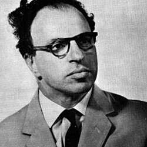

# Hermann Bondi

**Born:** 1 November 1919

**Died / status:** 10 September 2005

**Fields:** General relativity, Cosmology

Sourced portrait or photograph; see the image record for provenance and reuse conditions.

## Biography

An Austrian-born British mathematician and cosmologist, Bondi worked at Cambridge and King's College London and led scientific organizations. His research addressed gravitational radiation and cosmological models.

## Major contributions to physics

- Developed the treatment of gravitational radiation and Bondi mass.
- Proposed steady-state cosmology with Gold and Hoyle.
- Investigated gravitational accretion and relativistic astrophysics.

## Image source and rights

- Source: [Original image record](https://en.wikipedia.org/wiki/File:HermanBondi.jpg)
- Creator / attribution: See the original image record
- License or rights statement: Non-free historical photograph hosted by English Wikipedia under its fair-use rationale; that rationale does not grant a reusable image licence. Permission must be confirmed before website publication.
- Local image: [49b80738655a4a58f2d3-0135da8791.jpg](../portraits/49b80738655a4a58f2d3-0135da8791.jpg)
- Credit: ESRO / European Space Agency; reproduced on English Wikipedia
- Republication: permission for use on a public website has not been verified. Confirm permission with the rightsholder or replace the image before publication.

## Sources

- [Hermann Bondi — reference biography (en.wikipedia.org)](https://en.wikipedia.org/wiki/Hermann_Bondi)

Record reviewed: 2026-10-26.
