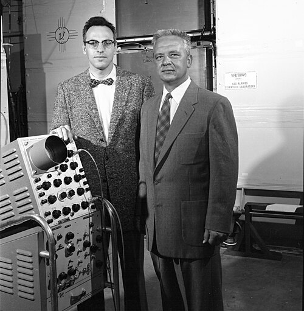

# Clyde Cowan

**Born:** 6 December 1919

**Died / status:** 24 May 1974

**Fields:** Neutrino physics, Nuclear physics

Clyde Cowan at left with Frederick Reines at right; this is a two-person photograph rather than a solo headshot.

## Biography

An American experimental physicist, Cowan worked at Los Alamos and later at the Catholic University of America. With Reines he used intense reactor antineutrino fluxes to detect extremely weak interactions.

## Major contributions to physics

- Made the first direct detection of electron antineutrinos with Reines.
- Developed coincidence-based reactor-neutrino experiments.
- Investigated particle detection and nuclear experimental techniques.

## Image source and rights

- Source: [Original image record](https://commons.wikimedia.org/wiki/File:Clyde_Cowan_and_Frederick_Reines.jpg)
- Creator / attribution: Savannah River Site
- License or rights statement: Public domain
- Local image: [16babca389a1b4a94c2e-71597789fc.jpg](../portraits/16babca389a1b4a94c2e-71597789fc.jpg)
- Credit: SRS at 60 -- The Discovery of Neutrinos

## Sources

- [Clyde Cowan — reference biography (en.wikipedia.org)](https://en.wikipedia.org/wiki/Clyde_Cowan)
- [Clyde Cowan — institutional or scholarly source (hyperphysics.phy-astr.gsu.edu)](http://hyperphysics.phy-astr.gsu.edu/hbase/particles/cowan.html)

Record reviewed: 2026-10-26.
