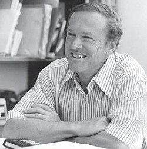

# Thomas Gold

**Born:** 22 May 1920

**Died / status:** 22 June 2004

**Fields:** Astrophysics, Cosmology

Sourced portrait or photograph; see the image record for provenance and reuse conditions.

## Biography

An Austrian-born astrophysicist who worked in Britain and at Cornell, Gold proposed wide-ranging and sometimes controversial hypotheses. His work contributed to pulsar interpretation, space science, and cosmology.

## Major contributions to physics

- Proposed rotating magnetized neutron stars as an explanation of pulsars.
- Developed steady-state cosmology with Bondi and Hoyle.
- Investigated planetary surfaces and space physics.

## Image source and rights

- Source: [Original image record](https://en.wikipedia.org/wiki/File:Thomas_Gold.jpg)
- Creator / attribution: See the original image record
- License or rights statement: Non-free historical photograph hosted by English Wikipedia under its fair-use rationale; that rationale does not grant a reusable image licence. Permission must be confirmed before website publication.
- Local image: [8040192cf93ae4bbdf15-9d8f4e044c.jpg](../portraits/8040192cf93ae4bbdf15-9d8f4e044c.jpg)
- Credit: Historical photograph reproduced on English Wikipedia; see file record for original credit
- Republication: permission for use on a public website has not been verified. Confirm permission with the rightsholder or replace the image before publication.

## Sources

- [Thomas Gold — reference biography (en.wikipedia.org)](https://en.wikipedia.org/wiki/Thomas_Gold)

Record reviewed: 2026-10-26.
