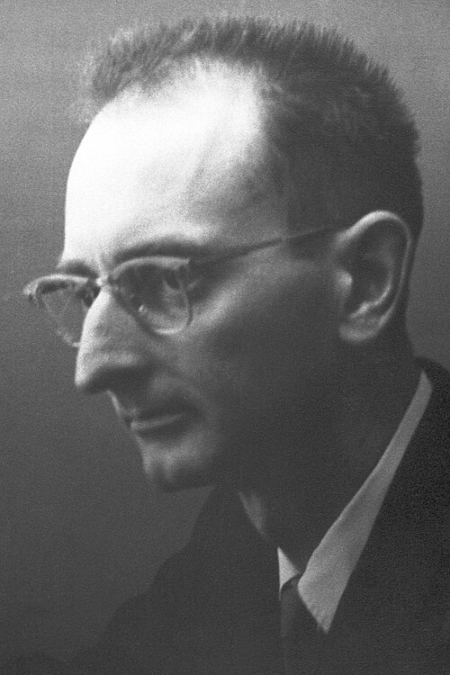

# Owen Chamberlain

**Born:** 10 July 1920

**Died / status:** 28 February 2006

**Fields:** Particle physics, Antimatter

For the photographer or artist, date and type of image, consult the original image record.

## Biography

Owen Chamberlain was born in San Francisco, CA, USA and conducted research in particle physics and antimatter. Nobel records list University of California as the affiliation at the time of the award. They discovered the antiproton in accelerator experiments. They were awarded the Nobel Prize in Physics in 1959.

## Major contributions to physics

- Discovered the antiproton in accelerator experiments
- Provided experimental evidence important to antimatter and particle-antiparticle symmetry

**Nobel Prize in Physics:** 1959

## Image source and rights

- Source: [Original image record](https://commons.wikimedia.org/wiki/File:Owen_Chamberlain.jpg)
- Creator / attribution: Nobel foundation
- License or rights statement: Public domain
- Local image: [caeeb22aade64eabfdb1.jpg](../portraits/caeeb22aade64eabfdb1.jpg)
- Credit: http://nobelprize.org/nobel_prizes/physics/laureates/1959/chamberlain-bio.html

## Sources

- [Owen Chamberlain - Facts](https://www.nobelprize.org/prizes/physics/1959/chamberlain/facts/)
- [Nobel Prize official laureate API, id 73](https://api.nobelprize.org/2.1/laureate/73)
- [Wikipedia: Owen Chamberlain](https://en.wikipedia.org/wiki/Owen_Chamberlain)

Record reviewed: 2026-10-26.
