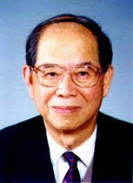

# Xie Jialin

**Born:** 8 August 1920

**Died / status:** 20 February 2016

**Fields:** Accelerator physics, Experimental physics

Sourced portrait or photograph; see the image record for provenance and reuse conditions.

## Biography

Born in Harbin, Xie earned his doctorate at Stanford and returned to China in 1955. He led high-energy electron-linear-accelerator and BEPC development, building major experimental-physics facilities.

## Major contributions to physics

- Developed an early high-energy-electron cancer-treatment accelerator.
- Led Chinese electron-linac and Beijing Electron–Positron Collider construction.
- Advanced free-electron lasers and accelerator technologies.

## Image source and rights

- Source: [Original image record](https://en.wikipedia.org/wiki/File:Xie_Jialin.jpeg)
- Creator / attribution: See the original image record
- License or rights statement: Non-free historical photograph hosted by English Wikipedia under its fair-use rationale; that rationale does not grant a reusable image licence. Permission must be confirmed before website publication.
- Local image: [28ecb930a802e171b113-ccd71f8a79.jpeg](../portraits/28ecb930a802e171b113-ccd71f8a79.jpeg)
- Credit: Government of the People’s Republic of China / Ministry of Science and Technology; reproduced on English Wikipedia
- Republication: permission for use on a public website has not been verified. Confirm permission with the rightsholder or replace the image before publication.

## Sources

- [Xie Jialin — institutional or scholarly source (ihep.cas.cn)](https://ihep.cas.cn/kydw/yszj/ygys/202210/t20221010_6521758.html)
- [Xie Jialin — reference biography (en.wikipedia.org)](https://en.wikipedia.org/wiki/Xie_Jialin)

Record reviewed: 2026-10-26.
