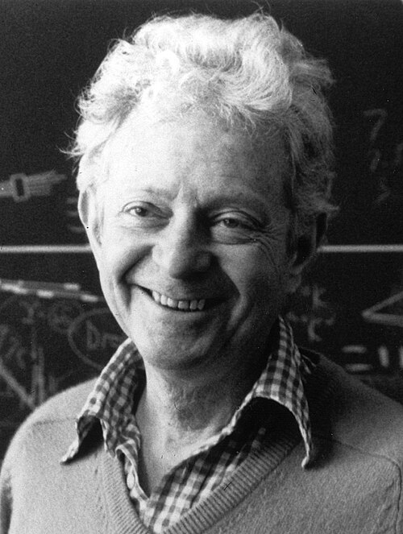

# Leon M. Lederman

**Born:** 15 July 1922

**Died / status:** 3 October 2018

**Fields:** Particle physics, Neutrinos

For the photographer or artist, date and type of image, consult the original image record.

## Biography

Leon M. Lederman was born in New York, NY, USA and conducted research in particle physics and neutrinos. Nobel records list Fermi National Accelerator Laboratory as the affiliation at the time of the award. They used a high-energy neutrino beam to discover the muon neutrino. They were awarded the Nobel Prize in Physics in 1988.

## Major contributions to physics

- Used a high-energy neutrino beam to discover the muon neutrino
- Established that electron and muon neutrinos are distinct

**Nobel Prize in Physics:** 1988

## Image source and rights

- Source: [Original image record](https://commons.wikimedia.org/wiki/File:Leon_M._Lederman_1988.jpg)
- Creator / attribution: ENERGY.GOV
- License or rights statement: Public domain
- Local image: [d5e02e3104d49a2b47fe.jpg](../portraits/d5e02e3104d49a2b47fe.jpg)
- Credit: HD.3F.001

## Sources

- [Leon M. Lederman - Facts](https://www.nobelprize.org/prizes/physics/1988/lederman/facts/)
- [Nobel Prize official laureate API, id 132](https://api.nobelprize.org/2.1/laureate/132)
- [Wikipedia: Leon M. Lederman](https://en.wikipedia.org/wiki/Leon_M._Lederman)

Record reviewed: 2026-10-26.
