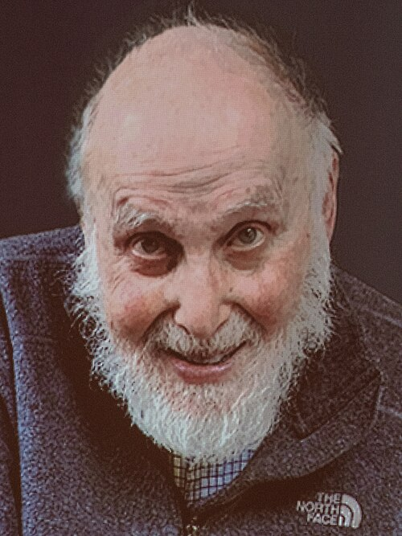

# Arthur Ashkin

**Born:** 2 September 1922

**Died / status:** 21 September 2020

**Fields:** Laser physics, Optical manipulation

For the photographer or artist, date and type of image, consult the original image record.

## Biography

Arthur Ashkin was born in New York, NY, USA and conducted research in laser physics and optical manipulation. Nobel records list Bell Laboratories as the affiliation at the time of the award. They invented optical tweezers, using radiation pressure to trap and manipulate microscopic objects. They were awarded the Nobel Prize in Physics in 2018.

## Major contributions to physics

- Invented optical tweezers, using radiation pressure to trap and manipulate microscopic objects
- Extended laser applications in microscopic physics and biophysics

**Nobel Prize in Physics:** 2018

## Image source and rights

- Source: [Original image record](https://commons.wikimedia.org/wiki/File:Arthur_Ashkin_EM1B5678_(44417135450).jpg)
- Creator / attribution: Bengt Nyman from Vaxholm, Sweden
- License or rights statement: [CC BY 2.0](https://creativecommons.org/licenses/by/2.0)
- Local image: [ed3d9fad69105676b840.jpg](../portraits/ed3d9fad69105676b840.jpg)
- Credit: Arthur Ashkin EM1B5678

## Sources

- [Arthur Ashkin - Facts](https://www.nobelprize.org/prizes/physics/2018/ashkin/facts/)
- [Nobel Prize official laureate API, id 960](https://api.nobelprize.org/2.1/laureate/960)
- [Wikipedia: Arthur Ashkin](https://en.wikipedia.org/wiki/Arthur_Ashkin)

Record reviewed: 2026-10-26.
