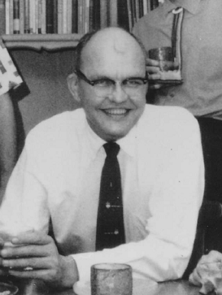

# Jack S. Kilby

**Born:** 8 November 1923

**Died / status:** 20 June 2005

**Fields:** Semiconductor physics, Microelectronics

For the photographer or artist, date and type of image, consult the original image record.

## Biography

Jack S. Kilby was born in Jefferson City, MO, USA and conducted research in semiconductor physics and microelectronics. Nobel records list Texas Instruments as the affiliation at the time of the award. They realized an early monolithic integrated circuit. They were awarded the Nobel Prize in Physics in 2000.

## Major contributions to physics

- Realized an early monolithic integrated circuit
- Advanced the integration of multiple electronic components on a single semiconductor substrate

**Nobel Prize in Physics:** 2000

## Image source and rights

- Source: [Original image record](https://commons.wikimedia.org/wiki/File:Jack_Kilby_(cropped).png)
- Creator / attribution: James R. Biard
- License or rights statement: [CC BY-SA 4.0](https://creativecommons.org/licenses/by-sa/4.0)
- Local image: [30144c26ab260388d1d0.png](../portraits/30144c26ab260388d1d0.png)
- Credit: Own work

## Sources

- [Jack Kilby - Facts](https://www.nobelprize.org/prizes/physics/2000/kilby/facts/)
- [Nobel Prize official laureate API, id 728](https://api.nobelprize.org/2.1/laureate/728)
- [Wikipedia: Jack Kilby](https://en.wikipedia.org/wiki/Jack_Kilby)

Record reviewed: 2026-10-26.
