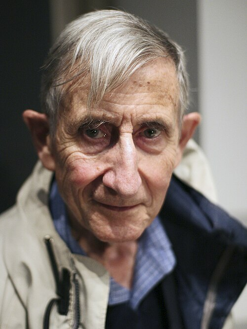

# Freeman Dyson

**Born:** 15 December 1923

**Died / status:** 28 February 2020

**Fields:** Quantum field theory, Mathematical physics

Sourced photograph or portrait; the image record identifies its creator, provenance, and reuse conditions.

## Biography

A British-born theorist and mathematician, Dyson studied at Cambridge before working at Cornell and the Institute for Advanced Study. Without completing a doctorate, he made foundational contributions to quantum electrodynamics and many-body theory.

## Major contributions to physics

- Demonstrated the equivalence of the Feynman and Tomonaga–Schwinger approaches to quantum electrodynamics.
- Developed the Dyson expansion and renormalization arguments.
- Studied the stability of matter with Lenard and advanced random-matrix applications in physics.

## Image source and rights

- Source: [Original image record](https://commons.wikimedia.org/wiki/File:Freeman_Dyson_%282005%29.jpg)
- Creator / attribution: ioerror
- License or rights statement: [CC BY-SA 2.0](https://www.flickr.com/photos/ioerror/49895337/)
- Local image: [bb19fc2df7cfcd8a04e2.jpg](../portraits/bb19fc2df7cfcd8a04e2.jpg)
- Credit: Flickr

## Sources

- [Freeman Dyson — biographical or institutional source (www.ias.edu)](https://www.ias.edu/press-releases/2020/freeman-j-dyson-1923%E2%80%932020)
- [Freeman Dyson — reference biography (en.wikipedia.org)](https://en.wikipedia.org/wiki/Freeman_Dyson)

Record reviewed: 2026-10-26.
