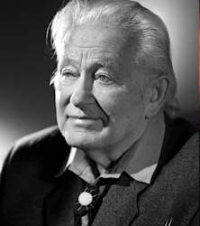

# Georges Charpak

**Born:** 1 August 1924

**Died / status:** 29 September 2010

**Fields:** Particle detection, Experimental physics

For the photographer or artist, date and type of image, consult the original image record.

## Biography

Georges Charpak was born in Dabrovica, Poland and conducted research in particle detection and experimental physics. Nobel records list École Supérieure de Physique et Chimie and CERN as the affiliations at the time of the award. They invented and developed the multiwire proportional chamber. They were awarded the Nobel Prize in Physics in 1992.

## Major contributions to physics

- Invented and developed the multiwire proportional chamber
- Enabled efficient position measurements and electronic readout of charged particles

**Nobel Prize in Physics:** 1992

## Image source and rights

- Source: [Original image record](https://commons.wikimedia.org/wiki/File:CHARPAK_Georges-24x50-2005_cropped.JPG)
- Creator / attribution: CHARPAK_Georges-24x50-2005.jpg: Studio Harcourt derivative work: Spatulli (talk)
- License or rights statement: [CC BY 3.0](https://creativecommons.org/licenses/by/3.0)
- Local image: [e2bbdffb12a11c16eb3b.jpg](../portraits/e2bbdffb12a11c16eb3b.jpg)
- Credit: CHARPAK_Georges-24x50-2005.jpg

## Sources

- [Georges Charpak - Facts](https://www.nobelprize.org/prizes/physics/1992/charpak/facts/)
- [Nobel Prize official laureate API, id 142](https://api.nobelprize.org/2.1/laureate/142)
- [Wikipedia: Georges Charpak](https://en.wikipedia.org/wiki/Georges_Charpak)

Record reviewed: 2026-10-26.
