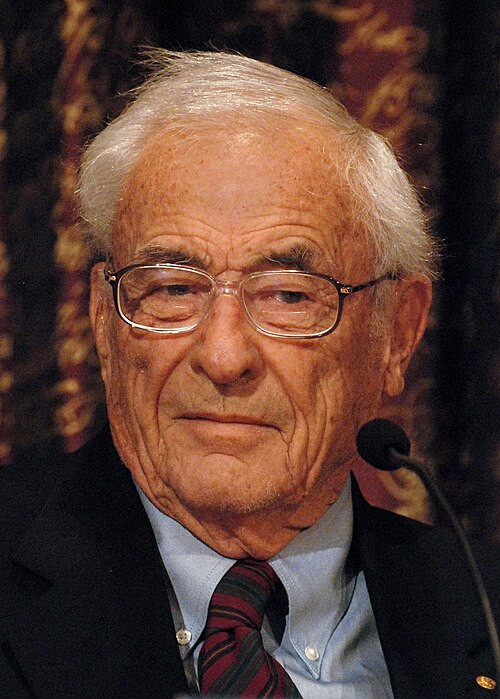

# Willard S. Boyle

**Born:** 19 August 1924

**Died / status:** 7 May 2011

**Fields:** Semiconductor physics, Imaging devices

For the photographer or artist, date and type of image, consult the original image record.

## Biography

Willard S. Boyle was born in Amherst, NS, Canada and conducted research in semiconductor physics and imaging devices. Nobel records list Bell Laboratories as the affiliation at the time of the award. They invented the charge-coupled device with George Smith. They were awarded the Nobel Prize in Physics in 2009.

## Major contributions to physics

- Invented the charge-coupled device with George Smith
- Provided an important technology for digital image sensing and astronomical imaging

**Nobel Prize in Physics:** 2009

## Image source and rights

- Source: [Original image record](https://commons.wikimedia.org/wiki/File:Nobel_Prize_2009-Press_Conference_KVA-23.jpg)
- Creator / attribution: Prolineserver (talk)
- License or rights statement: [CC BY-SA 3.0](https://commons.wikimedia.org/wiki/Commons:Credit_line)
- Local image: [f430462af2bd7070b2c3.jpg](../portraits/f430462af2bd7070b2c3.jpg)
- Credit: Own work

## Sources

- [Willard S. Boyle - Facts](https://www.nobelprize.org/prizes/physics/2009/boyle/facts/)
- [Nobel Prize official laureate API, id 839](https://api.nobelprize.org/2.1/laureate/839)
- [Wikipedia: Willard Boyle](https://en.wikipedia.org/wiki/Willard_Boyle)

Record reviewed: 2026-10-26.
