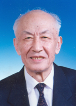

# Zhu Guangya

**Born:** 25 December 1924

**Died / status:** 26 February 2011

**Fields:** Nuclear physics

Sourced photograph or portrait; the image record identifies its creator, provenance, and reuse conditions.

## Biography

Born in Hubei, Zhu studied at the National Southwestern Associated University and earned his doctorate at Michigan before returning to China. He organized nuclear-weapons research and testing and helped establish defence-science institutions.

## Major contributions to physics

- Organized and contributed to nuclear-weapons physical design and testing in China.
- Coordinated theoretical, experimental, and engineering research.
- Advanced scientific training in nuclear and defence research.

## Image source and rights

- Source: [Original image record](https://www.cae.cn/cae/html/main/colys/90137628.html)
- Creator / attribution: Photographer not identified
- License or rights statement: Copyrighted or republication permission unverified; consult the original record
- Local image: [bccb6db62f3ca98bd753-f44a15293b.jpg](../portraits/bccb6db62f3ca98bd753-f44a15293b.jpg)
- Credit: Original credit is retained in the source record.
- Republication: permission for use on a public website has not been verified. Confirm permission with the rightsholder or replace the image before publication.

## Sources

- [Zhu Guangya — biographical or institutional source (www.caep.cn)](https://www.caep.cn/doc/2020/01/06/497.shtml)
- [Zhu Guangya — reference biography (en.wikipedia.org)](https://en.wikipedia.org/wiki/Zhu_Guangya)

Record reviewed: 2026-10-26.
