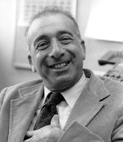

# Berni Alder

**Born:** 9 September 1925

**Died / status:** 7 September 2020

**Fields:** Computational physics, Statistical physics

Sourced photograph or portrait; the image record identifies its creator, provenance, and reuse conditions.

## Biography

A German-born American physicist associated with the University of California and Lawrence Livermore, Alder applied early electronic computers to particle systems. He helped establish molecular dynamics and computational statistical physics.

## Major contributions to physics

- Developed hard-sphere molecular-dynamics simulations with Wainwright.
- Investigated hard-sphere freezing and phase transitions numerically.
- Discovered long-time tails in fluid correlation functions and transport.

## Image source and rights

- Source: [Original image record](https://commons.wikimedia.org/wiki/File:Berni_Alder.jpg)
- Creator / attribution: US Department of Energy
- License or rights statement: Public domain
- Local image: [f3adb38897781e8e183c.jpg](../portraits/f3adb38897781e8e183c.jpg)
- Credit: https://web.archive.org/web/20100303041058/http://nnsa.energy.gov/news/2631.htm

## Sources

- [Berni Alder — reference biography (en.wikipedia.org)](https://en.wikipedia.org/wiki/Berni_Alder)

Record reviewed: 2026-10-26.
