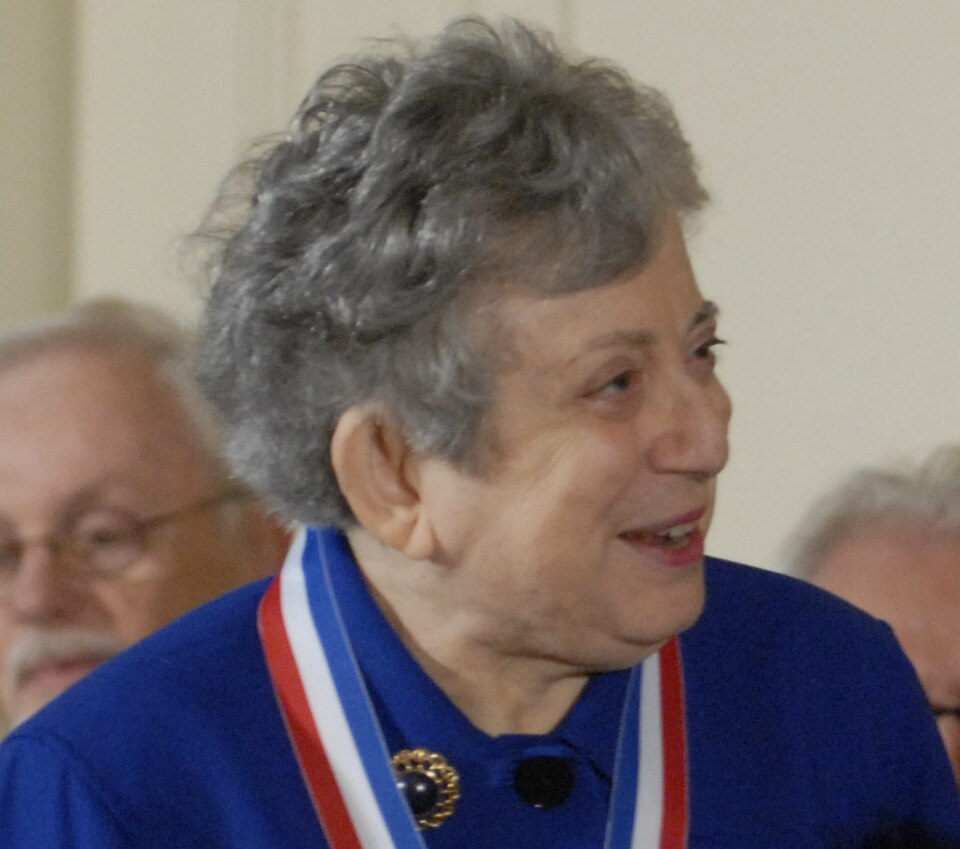

# Fay Ajzenberg-Selove

**Born:** 13 February 1926

**Died / status:** 8 August 2012

**Fields:** Nuclear physics

Sourced photograph or portrait; the image record identifies its creator, provenance, and reuse conditions.

## Biography

A German-born American nuclear physicist who experienced wartime displacement, Ajzenberg-Selove studied in the United States and taught at the University of Pennsylvania. She combined experiments with nuclear-level evaluations that became essential reference data.

## Major contributions to physics

- Investigated energy levels and reactions of light nuclei.
- Systematically evaluated light-nuclear-level data for comparisons of theory and experiment.
- Maintained and updated nuclear-data reference compilations.

## Image source and rights

- Source: [Original image record](https://commons.wikimedia.org/wiki/File:Fay_Ajzenberg-Selove2.jpg)
- Creator / attribution: Sandy Schaeffer for the National Science Foundation
- License or rights statement: Public domain
- Local image: [9108a1e520c1caed9941.jpg](../portraits/9108a1e520c1caed9941.jpg)

## Sources

- [Fay Ajzenberg-Selove — reference biography (en.wikipedia.org)](https://en.wikipedia.org/wiki/Fay_Ajzenberg-Selove)

Record reviewed: 2026-10-26.
