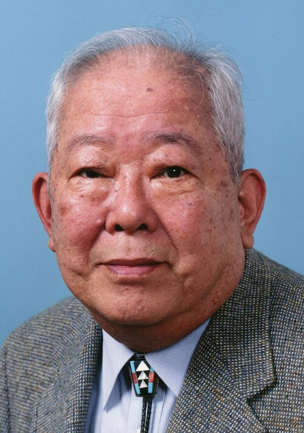

# Masatoshi Koshiba

**Born:** 19 September 1926

**Died / status:** 12 November 2020

**Fields:** Neutrino astronomy, Particle physics

For the photographer or artist, date and type of image, consult the original image record.

## Biography

Masatoshi Koshiba was born in Toyohashi, Japan and conducted research in neutrino astronomy and particle physics. Nobel records list University of Tokyo as the affiliation at the time of the award. They led the Kamiokande experiment. They were awarded the Nobel Prize in Physics in 2002.

## Major contributions to physics

- Led the Kamiokande experiment
- Observed neutrinos from supernova SN1987A and investigated solar neutrinos

**Nobel Prize in Physics:** 2002

## Image source and rights

- Source: [Original image record](https://commons.wikimedia.org/wiki/File:Masatoshi_Koshiba_2002.jpg)
- Creator / attribution: 内閣官房内閣広報室
- License or rights statement: [CC BY 4.0](http://www.kantei.go.jp/jp/m-magazine/backnumber/2002/kosiba.html)
- Local image: [11d696a22444fe13f6eb.jpg](../portraits/11d696a22444fe13f6eb.jpg)
- Credit: Original credit is retained in the source record.

## Sources

- [Masatoshi Koshiba - Facts](https://www.nobelprize.org/prizes/physics/2002/koshiba/facts/)
- [Nobel Prize official laureate API, id 754](https://api.nobelprize.org/2.1/laureate/754)
- [Wikipedia: Masatoshi Koshiba](https://en.wikipedia.org/wiki/Masatoshi_Koshiba)

Record reviewed: 2026-10-26.
