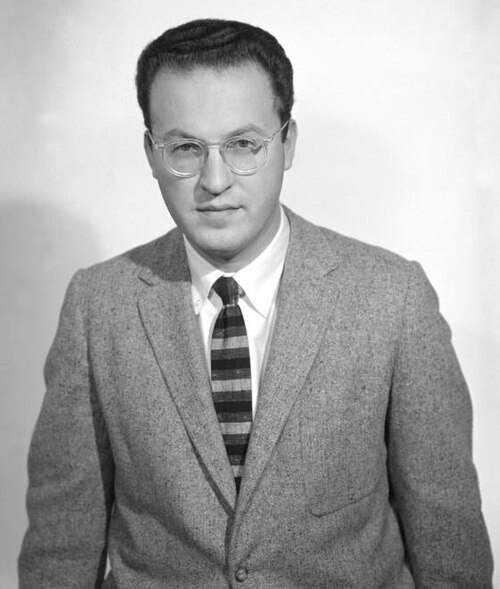

# Donald Arthur Glaser

**Born:** 21 September 1926

**Died / status:** 28 February 2013

**Fields:** Particle detection, Experimental physics

For the photographer or artist, date and type of image, consult the original image record.

## Biography

Donald Arthur Glaser was born in Cleveland, OH, USA and conducted research in particle detection and experimental physics. Nobel records list University of California as the affiliation at the time of the award. They invented the bubble chamber. They were awarded the Nobel Prize in Physics in 1960.

## Major contributions to physics

- Invented the bubble chamber
- Used superheated liquids to record charged-particle tracks in high-energy experiments

**Nobel Prize in Physics:** 1960

## Image source and rights

- Source: [Original image record](https://commons.wikimedia.org/wiki/File:Donald_Glaser.jpg)
- Creator / attribution: See the original image record
- License or rights statement: Public domain
- Local image: [ca7fdc3c3807303b8551.jpg](../portraits/ca7fdc3c3807303b8551.jpg)

## Sources

- [Donald A. Glaser - Facts](https://www.nobelprize.org/prizes/physics/1960/glaser/facts/)
- [Nobel Prize official laureate API, id 74](https://api.nobelprize.org/2.1/laureate/74)
- [Wikipedia: Donald A. Glaser](https://en.wikipedia.org/wiki/Donald_A._Glaser)

Record reviewed: 2026-10-26.
