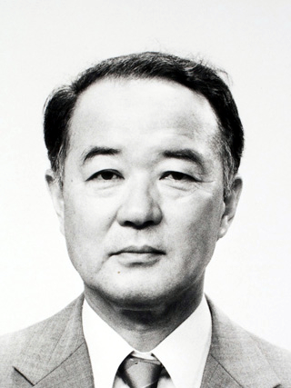

# Kazuhiko Nishijima

**Born:** 4 October 1926

**Died / status:** 15 February 2009

**Fields:** Particle physics, Quantum field theory

Sourced photograph or portrait; the image record identifies its creator, provenance, and reuse conditions.

## Biography

A Japanese theorist who worked at Osaka City University, American universities, and Tokyo, Nishijima interpreted newly discovered strange particles through new quantum-number relations. He later investigated gauge theory and confinement.

## Major contributions to physics

- Independently introduced quantum-number ideas explaining strange-particle production and decay.
- Established the relation now associated jointly with Gell-Mann and Nishijima.
- Investigated gauge properties and colour confinement in quantum field theory.

## Image source and rights

- Source: [Original image record](https://commons.wikimedia.org/wiki/File:Kazuhiko_Nishijima_cropped_Kazuhiko_Nishijima_19891212.jpg)
- Creator / attribution: 日本学士院
- License or rights statement: [CC BY 4.0](https://creativecommons.org/licenses/by/4.0)
- Local image: [2777c8cebc6448df5d03.jpg](../portraits/2777c8cebc6448df5d03.jpg)
- Credit: Original credit is retained in the source record.

## Sources

- [Kazuhiko Nishijima — biographical or institutional source (www.japan-acad.go.jp)](https://www.japan-acad.go.jp/en/news/2009/021701.html)
- [Kazuhiko Nishijima — reference biography (en.wikipedia.org)](https://en.wikipedia.org/wiki/Kazuhiko_Nishijima)

Record reviewed: 2026-10-26.
