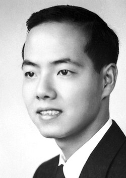

# Tsung-Dao (T.D.) Lee

**Born:** 24 November 1926

**Died / status:** 4 August 2024

**Fields:** Particle physics, Statistical physics

For the photographer or artist, date and type of image, consult the original image record.

## Biography

Tsung-Dao (T.D.) Lee was born in Shanghai, China and conducted research in particle physics and statistical physics. Nobel records list Columbia University as the affiliation at the time of the award. They proposed experimental tests of parity conservation in weak interactions with Chen Ning Yang. They were awarded the Nobel Prize in Physics in 1957.

## Major contributions to physics

- Proposed experimental tests of parity conservation in weak interactions with Chen Ning Yang
- Made contributions to particle physics and statistical many-body theory

**Nobel Prize in Physics:** 1957

## Image source and rights

- Source: [Original image record](https://commons.wikimedia.org/wiki/File:TD_Lee.jpg)
- Creator / attribution: Nobel foundation
- License or rights statement: Public domain
- Local image: [8eb0881ba50e724b01c2.jpg](../portraits/8eb0881ba50e724b01c2.jpg)
- Credit: http://nobelprize.org/nobel_prizes/physics/laureates/1957/index.html

## Sources

- [Tsung-Dao Lee - Facts](https://www.nobelprize.org/prizes/physics/1957/lee/facts/)
- [Nobel Prize official laureate API, id 69](https://api.nobelprize.org/2.1/laureate/69)
- [Wikipedia: Tsung-Dao Lee](https://en.wikipedia.org/wiki/Tsung-Dao_Lee)

Record reviewed: 2026-10-26.
