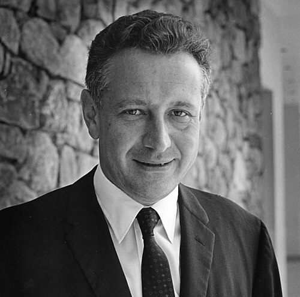

# Rolf Landauer

**Born:** 4 February 1927

**Died / status:** 27 April 1999

**Fields:** Statistical physics, Condensed-matter physics

A photograph of Landauer from 1969. Commons lists “Copyrighted free use”, but item-specific permission from the AIP source was not verified in this audit; website republication remains subject to permission.

## Biography

A German-born American physicist at IBM, Landauer investigated electronic transport and the physical costs of information processing, emphasizing that computation is implemented by physical systems.

## Major contributions to physics

- Formulated Landauer's principle for logically irreversible information erasure.
- Developed the Landauer formula for mesoscopic electronic transport.
- Investigated physical limits of computation and reversible information processing.

## Image source and rights

- Source: [Original image record](https://commons.wikimedia.org/wiki/File:Rolf_Landauer.jpg)
- Creator / attribution: Credit Line: AIP Emilio Segrè Visual Archives, Physics Today Collection
- License or rights statement: Copyright or reuse permission unverified; consult the original image record and audit note
- Local image: [50356b11ffc6d852c088-cc64343bb0.jpg](../portraits/50356b11ffc6d852c088-cc64343bb0.jpg)
- Credit: https://repository.aip.org/islandora/object/nbla%3A303523
- Republication: permission for use on a public website has not been verified. Confirm permission with the rightsholder or replace the image before publication.

## Sources

- [Rolf Landauer — reference biography (en.wikipedia.org)](https://en.wikipedia.org/wiki/Rolf_Landauer)

Record reviewed: 2026-10-26.
