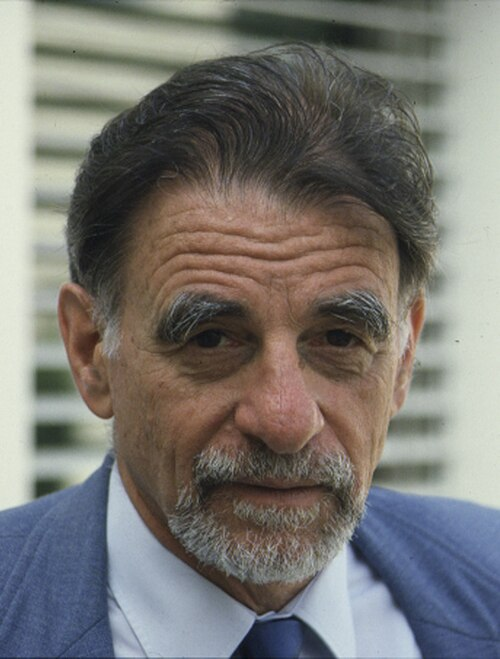

# K. Alexander Müller

**Born:** 20 April 1927

**Died / status:** 9 January 2023

**Fields:** Condensed-matter physics, Superconductivity

For the photographer or artist, date and type of image, consult the original image record.

## Biography

K. Alexander Müller was born in Basel, Switzerland and conducted research in condensed-matter physics and superconductivity. Nobel records list IBM Zurich Research Laboratory as the affiliation at the time of the award. They discovered high-temperature superconductivity in copper-oxide materials. They were awarded the Nobel Prize in Physics in 1987.

## Major contributions to physics

- Discovered high-temperature superconductivity in copper-oxide materials
- Opened new research on unconventional superconductivity and strongly correlated electrons

**Nobel Prize in Physics:** 1987

## Image source and rights

- Source: [Original image record](https://commons.wikimedia.org/wiki/File:Head_photo_of_K_Alex_Mueller,_Nobel_Laureate,_in_the_1980s_(cropped).jpg)
- Creator / attribution: Ibmzrl
- License or rights statement: [CC BY 3.0](https://creativecommons.org/licenses/by/3.0)
- Local image: [f2fdfaf38971ba7696ae.jpg](../portraits/f2fdfaf38971ba7696ae.jpg)
- Credit: Template:IBM Research - Zurich

## Sources

- [K. Alex Müller - Facts](https://www.nobelprize.org/prizes/physics/1987/muller/facts/)
- [Nobel Prize official laureate API, id 131](https://api.nobelprize.org/2.1/laureate/131)
- [Wikipedia: K. Alex Müller](https://en.wikipedia.org/wiki/K._Alex_M%C3%BCller)

Record reviewed: 2026-10-26.
