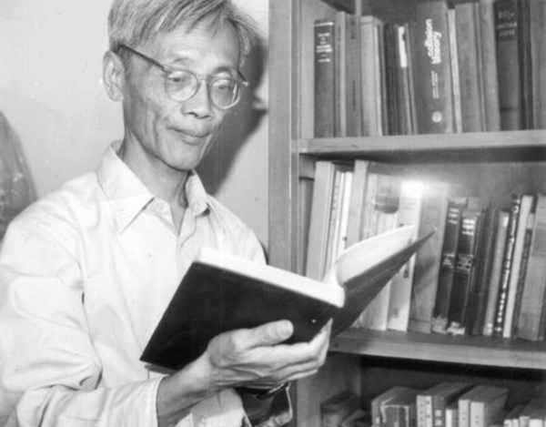

# Dai Yuanben

**Born:** 15 July 1928

**Died / status:** 26 September 2020

**Fields:** Particle physics, Quantum field theory

Historical photograph of Dai Yuanben reading at home; the China Scientists Museum credits the Chinese Academy of Sciences.

## Biography

Born in Nanjing, Dai conducted particle-theory research at the Chinese Academy of Sciences. He studied strong interactions, hadron structure, and quantum fields and helped build theoretical-physics institutions.

## Major contributions to physics

- Investigated hadron structure and strong-interaction phenomenology.
- Developed heavy-quark and quantum-chromodynamics calculations.
- Advanced particle-theory research and scientific training.

## Historical and source notes

- Sources differ between 15 and 31 July. This archive adopts 15 July 1928 from the Institute of Theoretical Physics and the China Scientists Museum and preserves the discrepancy.

## Image source and rights

- Source: [Original image record](https://mmcs.cast.org.cn/xwz/kxjrl/art/2026/art_be9e2f7c0176440e9252583417cc12f4.html)
- Creator / attribution: See the original image record
- License or rights statement: Copyrighted image; no transferable open licence verified. Permission must be confirmed before website publication.
- Local image: [f2597dcb8f1e911f1227-da28d191fa.png](../portraits/f2597dcb8f1e911f1227-da28d191fa.png)
- Credit: Chinese Academy of Sciences; reproduced by the China Scientists Museum
- Republication: permission for use on a public website has not been verified. Confirm permission with the rightsholder or replace the image before publication.

## Sources

- [Dai Yuanben — institutional or scholarly source (mmcs.cast.org.cn)](https://mmcs.cast.org.cn/xwz/kxjrl/art/2026/art_be9e2f7c0176440e9252583417cc12f4.html)
- [Dai Yuanben — institutional or scholarly source (www.itp.cas.cn)](https://www.itp.cas.cn/sourcedb_itp_cas/zw/zjrck/ys/202107/t20210723_6145287.html)
- [Dai Yuanben — reference biography (en.wikipedia.org)](https://en.wikipedia.org/wiki/Dai_Yuanben)

Record reviewed: 2026-10-26.
