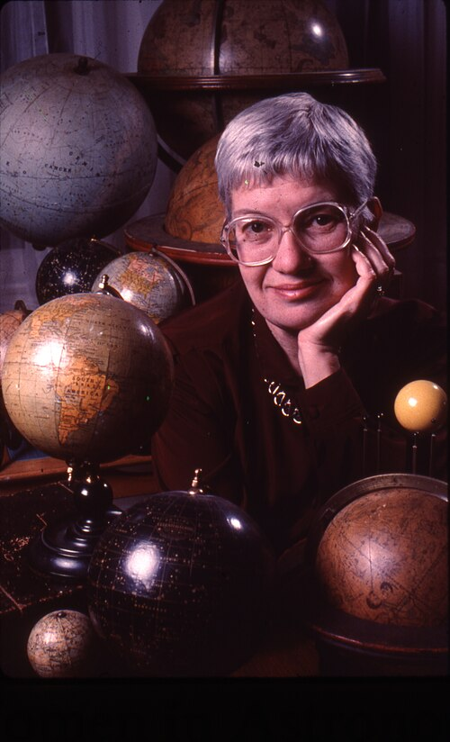

# Vera Rubin

**Born:** 23 July 1928

**Died / status:** 25 December 2016

**Fields:** Galactic dynamics, Dark matter

Sourced photograph or portrait; the image record identifies its creator, provenance, and reuse conditions.

## Biography

An American observational astronomer educated at Cornell and Georgetown, Rubin worked at the Carnegie Institution. With Ford, she used sensitive spectroscopy to measure galaxy rotation and advocated equal opportunities for women in research.

## Major contributions to physics

- Measured spiral-galaxy rotation curves systematically with Kent Ford.
- Established persistent outer-galaxy rotation speeds as strong evidence for unseen matter.
- Investigated galaxy motions and large-scale structure.

## Image source and rights

- Source: [Original image record](https://commons.wikimedia.org/wiki/File:Vera_Rubin_with_antique_globes.jpg)
- Creator / attribution: Photograph by Mark Godfrey, courtesy of AIP Emilio Segrè Visual Archives, Gift of Vera Rubin
- License or rights statement: Attribution
- Local image: [c067d6229230998cad8a.jpg](../portraits/c067d6229230998cad8a.jpg)
- Credit: https://repository.aip.org/node/111858

## Sources

- [Vera Rubin — reference biography (en.wikipedia.org)](https://en.wikipedia.org/wiki/Vera_Rubin)

Record reviewed: 2026-10-26.
